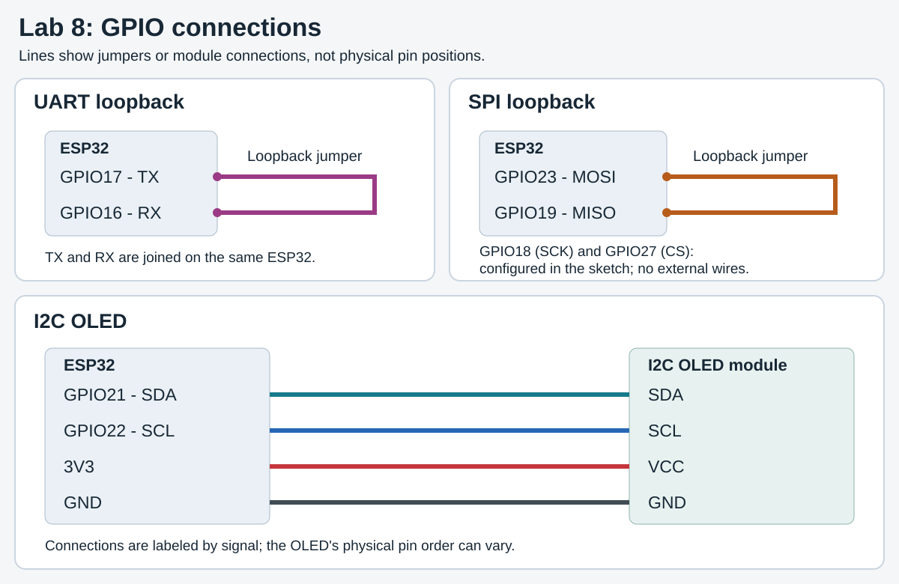
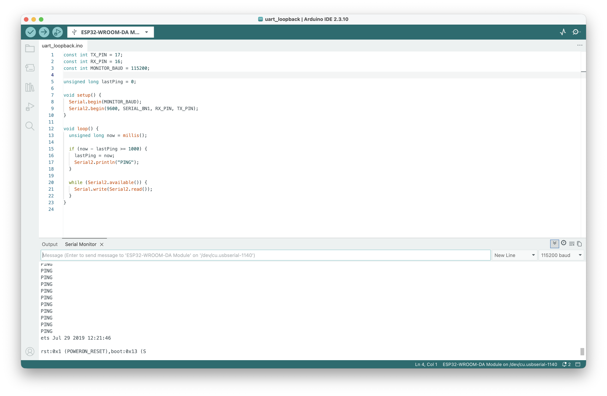
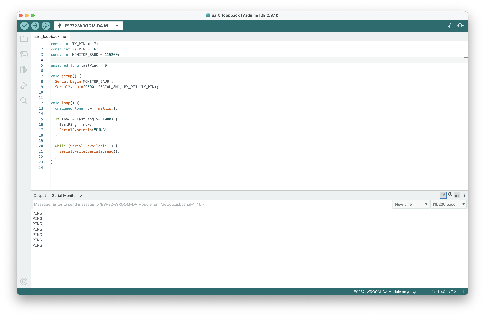
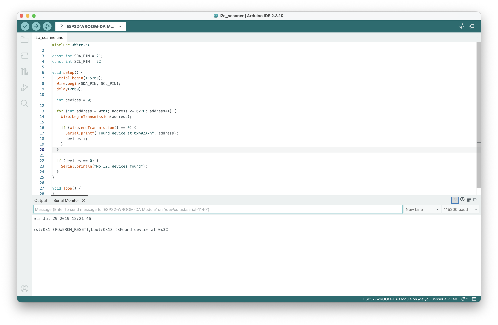
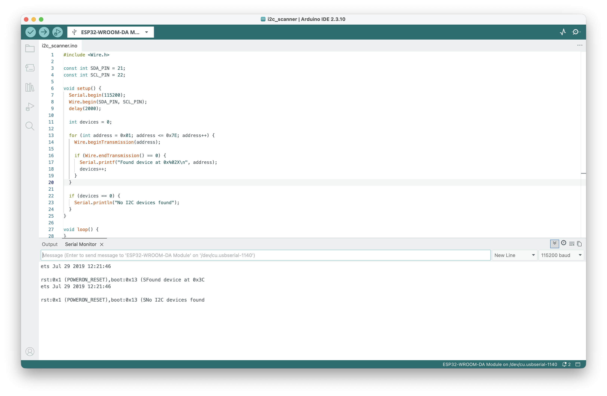
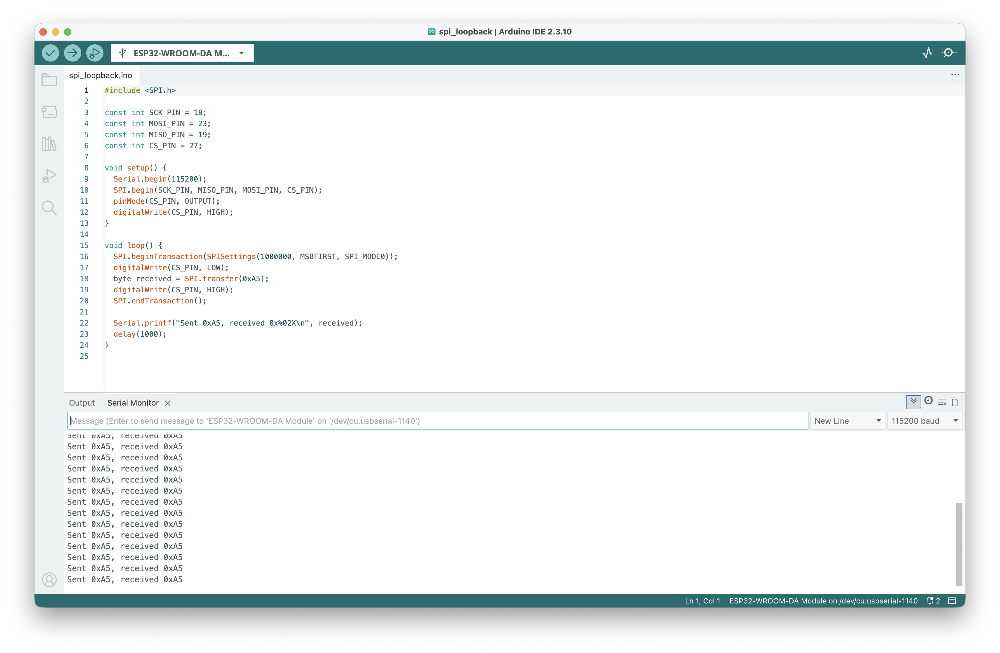
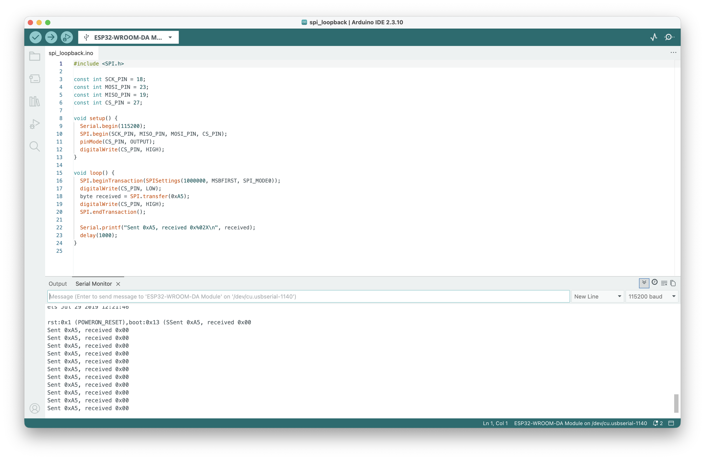
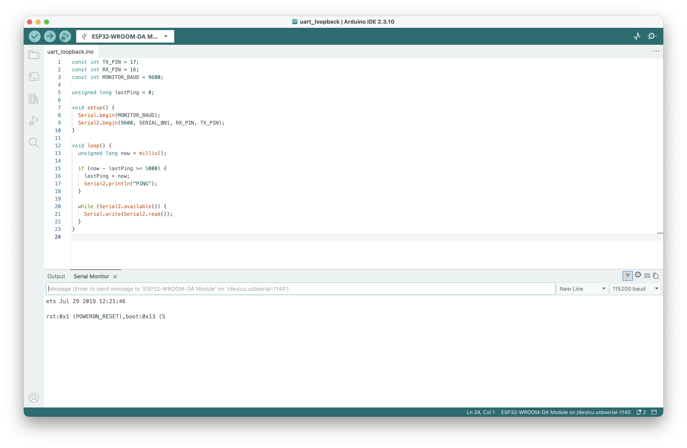
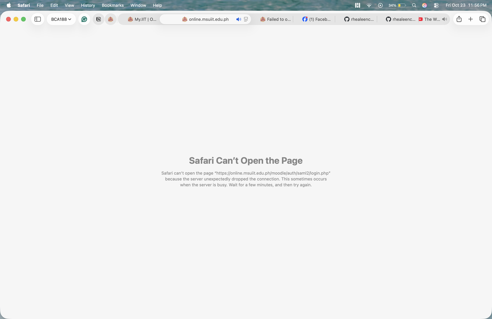

# Laboratory Activity 8: Wired Communication

**Rhea Leen P. Castor**

BCA188 - Programming For Internet of Things

I tested UART, I2C, and SPI using an ESP32 and an I2C OLED.

## Pins and connections

| Signal | GPIO | Connection |
|---|---:|---|
| UART TX | 17 | GPIO16 |
| UART RX | 16 | GPIO17 |
| I2C SDA | 21 | OLED SDA |
| I2C SCL | 22 | OLED SCL |
| SPI SCK | 18 | Configured in the sketch; no external wire for loopback |
| SPI MOSI | 23 | GPIO19 |
| SPI MISO | 19 | GPIO23 |
| SPI CS | 27 | Configured in the sketch; no external wire for loopback |

I connected the OLED's VCC to **3V3** and GND to **GND**. The diagram shows the GPIO connections used by my sketches.

## Sketches

- [uart_loopback](uart_loopback/uart_loopback.ino): sends PING through Serial2 at 9600 baud and prints the received bytes.
- [i2c_scanner](i2c_scanner/i2c_scanner.ino): scans for the OLED's I2C address once at startup.
- [spi_loopback](spi_loopback/spi_loopback.ino): sends 0xA5 at 1 MHz, MSB first, using SPI mode 0.

I uploaded the sketches separately and used Serial Monitor at **115200 baud**, except for the matching 9600-baud test.

## Results

| Test | Expected | Observed | Screenshot |
|---|---|---|---|
| UART with jumper | PING once per second | PING appeared once per second. | [Uploaded](documentation/uart-with-jumper.png) |
| UART without jumper | No repeated PING | No new PING appeared after disconnection; older lines remained visible. | [Uploaded](documentation/uart-without-jumper.png) |
| I2C with OLED | OLED address detected | Found device at 0x3C. | [Uploaded](documentation/i2c-with-oled.png) |
| I2C without OLED | No devices detected | No I2C devices found. | [Uploaded](documentation/i2c-without-oled.png) |
| SPI with jumper | 0xA5 received | Received 0xA5. | [Uploaded](documentation/spi-with-jumper.png) |
| SPI without jumper | A value different from 0xA5 | Sent 0xA5, received 0x00. | [Uploaded](documentation/spi-without-jumper.png) |
| UART USB serial at 9600, monitor at 115200 | Unreadable PING output | Only startup text is visible; no readable PING appears in this capture. | [Uploaded](documentation/uart-9600-monitor-115200.png) |
| UART USB serial at 9600, monitor at 9600 | Readable PING | PING was readable with both baud rates set to 9600. | [Uploaded](documentation/uart-9600-monitor-9600.png) |

All eight test captures are included below.

## Questions

**Why does UART need matching baud rates, while SPI uses a clock line?**

UART has no separate clock, so both sides need matching bit timing to read the data correctly. SPI uses SCK to synchronize the data.

**Why can't two devices with the same address share one I2C bus?**

Both devices would respond to the same address, so the controller could not select them separately. Their responses could also interfere with each other.

**Why is CS HIGH between SPI transfers?**

For active-low CS, HIGH deselects the device and ends the transfer. LOW selects it for the next transfer.

## Documentation

My original screenshots are saved in [documentation](documentation/).

1. UART with jumper — PING received

The monitor shows repeated PING lines. USB serial is set to 115200 baud, while Serial2 uses 9600 baud.

2. UART without jumper — no new PING

After I disconnected the jumper, no new PING lines appeared. The PING lines visible in this screenshot were left over from the earlier test with the jumper connected.

3. I2C with OLED — address 0x3C found

The scanner detected the OLED at address **0x3C**. This test checks its I2C response, so the screen does not need to display anything.

4. I2C without OLED — no devices found

After the next reset, the scanner printed **No I2C devices found**. The older 0x3C result is still visible above that reset.

5. SPI with jumper — 0xA5 received

The monitor shows **Sent 0xA5, received 0xA5**, so the transmitted and received bytes matched.

6. SPI without jumper — 0x00 received

With the MOSI-to-MISO jumper disconnected, the monitor shows **Sent 0xA5, received 0x00**. The received byte differed from 0xA5. This was my observed value; an unconnected MISO does not have one guaranteed value.

7. UART code 9600 / monitor 115200 — no readable PING

My code is set to **9600 baud**, while Serial Monitor is set to **115200 baud**. This capture shows startup text but no readable PING. The startup text is separate from the loopback output.

8. UART code 9600 / monitor 9600 — readable PING

With my code and Serial Monitor both set to **9600 baud**, PING was readable again. This shows the difference between matching baud rates and the earlier 9600/115200 settings.

## MOLE access issues

I could not open the MOLE sign-in page in Safari on October 23 at 11:56 PM. My mobile dashboard also showed loading indicators.

Desktop sign-in error and mobile loading screen

**Desktop:** Safari reported that the server unexpectedly dropped the connection.

**Mobile:** the dashboard showed loading indicators at 23:58.

