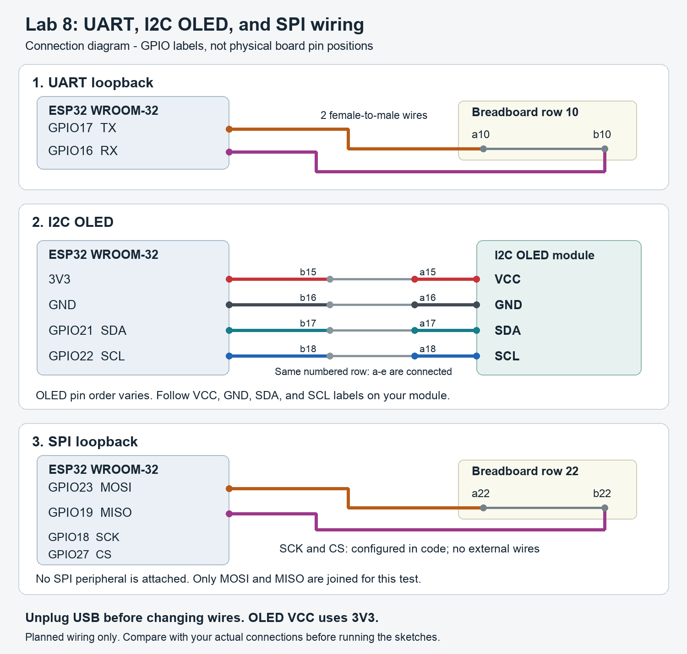

# Laboratory Activity 8: Wired Communication

Rhea Leen Castor  
BCA188 - Programming For Internet of Things

This activity tests UART, I2C, and SPI on an ESP32 WROOM-32 using two loopback connections and an I2C OLED module.

Status: sketches and wiring plan prepared. Hardware tests and observed results are still to be completed.

## Materials

- 1 ESP32 WROOM-32 development board
- 1 USB data cable
- 1 breadboard
- 1 I2C OLED module
- 8 female-to-male jumper wires from the ESP32 to the breadboard
- Extra female-to-male wires if the OLED cannot plug directly into the breadboard
- Computer with Arduino IDE and the board's pinout diagram

## Pin table

| Signal | GPIO used |
|---|---:|
| UART TX | 17 |
| UART RX | 16 |
| I2C SDA | 21 |
| I2C SCL | 22 |
| SPI SCK | 18 |
| SPI MOSI | 23 |
| SPI MISO | 19 |
| SPI CS | 27 |

## Wiring

Unplug USB before changing any wires. Use the GPIO labels on the board, since physical pin positions vary. These choices are for a WROOM-32 board; avoid flash pins, strapping pins, and input-only pins for outputs. Power the OLED from 3V3.



This is a connection diagram, not a picture of the actual build. Check that the wiring matches it before testing.

The ESP32 sits beside the breadboard. Attach the female ends to its header pins and put the male ends into the breadboard. On a standard breadboard, holes a-e in the same numbered row are connected. Holes f-j form a separate connected strip across the center gap.

| Connection | Breadboard arrangement |
|---|---|
| UART TX to RX | GPIO17 to a10; GPIO16 to b10 |
| OLED VCC | OLED VCC to a15; ESP32 3V3 to b15 |
| OLED GND | OLED GND to a16; ESP32 GND to b16 |
| OLED SDA | OLED SDA to a17; GPIO21 to b17 |
| OLED SCL | OLED SCL to a18; GPIO22 to b18 |
| SPI MOSI to MISO | GPIO23 to a22; GPIO19 to b22 |

The OLED rows are examples based on its labels. If its pins are in a different order, move the ESP32 wires to the matching rows. Never put all four OLED pins into one connected strip.

SCK uses GPIO18 and CS uses GPIO27 in the SPI sketch. They do not need external wires for this MOSI-to-MISO loopback because there is no SPI peripheral attached. The sketch still generates SCK and switches CS.

## Running the sketches

1. In Arduino IDE, install **esp32 by Espressif Systems** in Boards Manager if needed.
2. Select the matching ESP32 board and its USB port under **Tools**. For a generic WROOM-32 development board, use **ESP32 Dev Module**.
3. Open the `.ino` file inside the folder for the test. Keep each sketch in its own folder and upload one sketch at a time.
4. Check the pin numbers at the top of the sketch against the wiring.
5. Open Serial Monitor at **115200 baud**. If startup output was missed, press the board's **EN/RESET** button while the monitor is open.

`Wire` and `SPI` come with the ESP32 board package. The scanner does not need an OLED display library and does not draw anything on the OLED.

### 1. UART loopback

Open [uart_loopback.ino](uart_loopback/uart_loopback.ino) and upload it. Serial2 uses 9600 baud, 8 data bits, no parity, and 1 stop bit.

- With GPIO17 connected to GPIO16, record the received `PING` lines in Serial Monitor.
- Unplug USB, disconnect one end of the UART connection, reconnect USB, and record the difference.
- Unplug USB and restore the connection before continuing.

The sketch prints only bytes received through Serial2. With the loopback disconnected, there should be no repeated `PING`; an open RX pin may occasionally pick up noise.

### 2. I2C scanner

Open [i2c_scanner.ino](i2c_scanner/i2c_scanner.ino) and upload it with the OLED connected. The scanner checks 0x01 through 0x7E once after startup.

- Open Serial Monitor, press EN/RESET, and record every address found.
- Unplug USB and disconnect all four OLED connections. Reconnect USB, open Serial Monitor, press EN/RESET, and record the scan without the module.
- Unplug USB and restore the OLED connections.

Many OLED modules use 0x3C, but record the actual address shown. The OLED can stay blank during this test.

### 3. SPI loopback

Open [spi_loopback.ino](spi_loopback/spi_loopback.ino) and upload it. The settings are 1 MHz, most-significant-bit first, and SPI mode 0.

- With GPIO23 connected to GPIO19, record the received values. Each line should show `Sent 0xA5, received 0xA5`.
- Unplug USB, disconnect one end of the SPI loopback, reconnect USB, and record the received values.
- Unplug USB and restore the loopback connection.

Without the loopback, MISO is floating, so the received value is not guaranteed. It may be 0x00, 0xFF, or another value; record what actually happens.

### 4. USB serial baud test

1. Keep the UART loopback connected and open `uart_loopback.ino`.
2. Change `MONITOR_BAUD` from `115200` to `9600`. Leave `Serial2.begin(9600, SERIAL_8N1, RX_PIN, TX_PIN)` unchanged.
3. Upload the sketch and leave Serial Monitor at **115200 baud**. Record what appears.
4. Change Serial Monitor to **9600 baud** and record what appears again.
5. Restore `MONITOR_BAUD` to `115200`, upload again, and set Serial Monitor back to **115200 baud**.

ESP32 boot messages may use a different baud rate from the sketch. Compare the repeating sketch output after startup.

## Expected versus observed

The Expected column contains predictions. Replace each `Not tested` entry only after running that test.

| Test | Expected | Observed |
|---|---|---|
| UART with jumper | PING appears once per second. | Not tested |
| UART without jumper | Repeated PING stops; occasional noise is possible. | Not tested |
| I2C with module | Found device at 0x.. with the OLED's address, possibly 0x3C. | Not tested |
| I2C without module | No I2C devices found | Not tested |
| SPI with jumper | Sent 0xA5, received 0xA5 once per second. | Not tested |
| SPI without jumper | Usually a different value; floating MISO has no guaranteed value. | Not tested |
| Sketch at 9600, monitor at 115200 | Unreadable characters or no readable PING. | Not tested |
| Sketch at 9600, monitor at 9600 | Readable PING once per second. | Not tested |

## Serial Monitor output

Paste actual output into each section below. If a test produces no output, write that observation and how long the monitor was watched. Screenshots can be added instead of text.

### UART with jumper

```text
Pending: paste actual output here.
```

### UART without jumper

```text
Pending: paste actual output or describe the blank monitor here.
```

### I2C with OLED

```text
Pending: paste actual output and every address found here.
```

### I2C without module

```text
Pending: paste actual output here.
```

### SPI with jumper

```text
Pending: paste actual output here.
```

### SPI without jumper

```text
Pending: paste actual output here.
```

### Sketch at 9600, monitor at 115200

```text
Pending: paste actual output or add a screenshot here.
```

### Sketch at 9600, monitor at 9600

```text
Pending: paste actual output here.
```

## Questions

**1. Why does UART need both sides to use the same baud rate, while SPI uses a clock line?**

UART has no separate clock line, so both sides need the same bit timing to read the data correctly. SPI uses SCK to tell the devices when to sample each bit.

**2. Why can two devices with the same address not share one I2C bus?**

Both devices would respond when that address is called, so the controller could not select just one and their responses could interfere. They need different addresses or separate bus channels.

**3. Why is CS set HIGH between SPI transfers?**

For an active-low CS device, setting CS HIGH deselects it and marks the end of the transfer. Pulling CS LOW selects it for the next transfer.

## Before submission

- Complete all eight tests and replace the pending output sections with real evidence.
- Fill in the Observed column and check the wiring diagram against the actual connections.
- Restore the UART sketch and Serial Monitor to 115200 baud.
- Submit this repository's URL in MOLE.

## References

- [Espressif UART documentation](https://docs.espressif.com/projects/arduino-esp32/en/latest/api/serial.html)
- [Espressif I2C documentation](https://docs.espressif.com/projects/arduino-esp32/en/latest/api/i2c.html)
- [Espressif SPI documentation](https://docs.espressif.com/projects/arduino-esp32/en/latest/api/spi.html)
